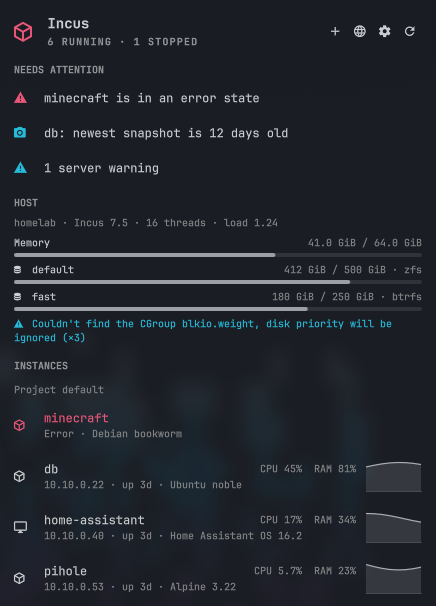

# Omacus

Incus in the Omarchy bar. Omacus shows the containers and VMs on every Incus server your `incus` client knows about, and keeps them current from Incus's own event stream.



## What you get

- **Bar icon** with the number of running instances (or running/total, or icon only). It turns red when something needs you: an instance in an error state, a watched instance that stopped, a server you can't reach, a storage pool over 95%, or a cluster member offline.
- **Needs attention** list at the top of the panel:
  - instances in an error state
  - watched instances that aren't running
  - unreachable servers
  - storage pools past your warning level
  - offline cluster members
  - server warnings
  - running instances whose newest snapshot is older than you want
- **Instances** across all servers, or one server at a time, grouped by project. Each row shows:
  - status
  - IPv4 address
  - uptime
  - OS
  - CPU and memory use, with a CPU graph of the last 15 minutes
- **Instance details** (click or press `l`):
  - all addresses, memory, disk, CPU limit, network traffic
  - image and how old it is
  - snapshot count, age of the newest, schedule
  - backups, forwarded ports, profiles, cluster member
  - a hint when a VM's guest agent isn't running, since IP and memory are then unknown
- **Actions**:
  - start, stop, restart, pause, force stop and snapshot
  - open a shell, or a console (a text console for containers, the VM's screen for VMs)
  - copy the IP
  - watch or unwatch
  - stop, restart, pause and force stop ask for a second click
- **Host section** per server:
  - Incus version, CPU threads and load
  - memory
  - storage pool fill
  - cluster members
  - warnings
  - running tasks with progress, such as image downloads
- **New instance**: launch from an image (`images:debian/13`, say) as a container or VM, in a terminal so you see the progress.
- **Web UI** button for HTTPS remotes, opening `https://<server>:8443/ui/`. This needs the `incus-ui` package on the server.
- **Notifications**:
  - an instance stops that you didn't stop from the panel
  - an instance enters an error state
  - a storage pool crosses your warning level
  - a cluster member goes offline
  - a server stays unreachable for a minute, and again when it's back

## Requirements

- Omarchy with the Quattro shell.
- The `incus` client. Omacus never runs an Incus server on your machine; it only needs the command. Either:
  - `omarchy pkg add incus` (the Arch package also ships the server, which stays off unless you enable `incus.socket`), or
  - the standalone client from the [Incus releases](https://github.com/lxc/incus/releases) (`bin.linux.incus.x86_64` or `.aarch64`), saved as `~/.local/bin/incus` and made executable.
- At least one remote. On the server:

  ```bash
  incus config trust add laptop      # prints a one-time token
  ```

  Then on this machine:

  ```bash
  incus remote add homelab <token>
  ```

  Omacus picks the new remote up when the client config changes, or at the latest the next time you open the panel. It uses the certificates the `incus` client already manages, and never asks for or stores a token or password.

## Install

```bash
omarchy plugin add https://github.com/dmkenney/omacus.git --enable
```

## Settings

The panel's settings button (the cog) covers read-only mode, the CPU graph, notifications and the bar label. Everything else is set with `omarchy bar set`:

| Setting | Default | Meaning |
|---|---|---|
| `remotes` | empty | Comma-separated remote names to show. Empty shows all. A local remote with no running daemon is hidden unless you name it. |
| `barLabel` | `none` | `none` (icon only), `running` (running count) or `running-total` (running/total). |
| `notifications` | `all` | `all`, `watched` (stops only for watched instances, plus server problems) or `off`. |
| `watched` | empty | Comma-separated `remote:instance` pairs. Also toggled with the eye button on an instance. |
| `readOnly` | `false` | Hide every action that changes anything. |
| `snapshotWarnDays` | `7` | Flag running instances whose newest snapshot is older than this. `0` turns it off. |
| `poolWarnPercent` | `85` | Flag storage pools at least this full. |
| `statsIntervalSec` | `5` | How often CPU and memory refresh while the panel is open. |
| `backgroundStats` | `true` | Read CPU use every 30 seconds while the panel is closed, so each instance shows a 15-minute CPU graph. `false` stops that polling and hides the graph. |
| `incusPath` | empty | Full path to the client. Empty looks in `/usr/bin`, `/usr/local/bin`, `~/.local/bin` and `~/bin`. |

```bash
omarchy bar set io.github.dmkenney.omacus remotes "homelab,nas"
omarchy bar set io.github.dmkenney.omacus readOnly true --json
omarchy bar set io.github.dmkenney.omacus snapshotWarnDays 14 --json
```

For one bar item per server, add the widget twice and give each its own `remotes`.

## Keys

| Key | Action |
|---|---|
| `j` / `k` | Move down / up. The header buttons (new instance, web UI, settings, refresh) are the first stop |
| `l` / `h` | Move between header buttons; expand an instance, then move between its buttons / collapse |
| `Enter` / `Space` | Open the row, or press the selected button |
| `/` | Filter by name, IP, project, image or profile |
| `s` | Shell into the selected instance |
| `c` | Copy its IP |
| `w` | Watch or unwatch it |
| `n` | New instance |
| `r` | Refresh |
| `Esc` | Collapse, clear the filter, then close |

The panel also answers to `omarchy-shell io.github.dmkenney.omacus toggle` (and `open`, `close`, `refresh`) for your own key bindings.

## How it works

- `helper.py` runs every `incus` command with a deadline, an output size cap and its own process group, and prints a small JSON document.
- Each server gets one full read (`incus query` of instances, resources, storage pools, warnings and operations) and then one long-running `incus monitor` for lifecycle and operation events. An event triggers a re-read of that server, so nothing polls while the panel is closed.
- CPU and memory have no events, so they are polled: every `statsIntervalSec` while the panel is open, and every 30 seconds otherwise (unless `backgroundStats` is off). CPU is shown as a share of what the instance may use (its `limits.cpu`, or the host's threads).
- If a server drops, Omacus reconnects after 2 s, 4 s, 8 s and so on, up to five minutes, and re-reads it when the stream is back.
- A restricted client certificate that can't list every project falls back to the remote's own project.

## Privacy and security

- Omacus talks to your servers only through the `incus` client, with the remotes and certificates you set up. It opens no network connections of its own and sends nothing anywhere else.
- It writes no files. Settings live in its entry in `~/.config/omarchy/shell.json`. It only watches `~/.config/incus/config.yml` for changes, and never reads it.
- Shell, console and launch open a terminal running `incus exec`, `incus console` or `incus launch`. Copy uses `wl-copy`; the web UI opens in your browser through `omarchy-launch-browser`.
- Instance names, projects and remotes are checked against Incus's naming rules before any command runs, and every command is passed as an argument list, never a shell string.
- Read-only mode hides every action, but it is a convenience, not a permission boundary. To limit what this machine can do, restrict its certificate on the server (`incus config trust add --restricted --projects ...`).

## Removing

```bash
omarchy plugin remove io.github.dmkenney.omacus
```

This removes the plugin folder and its bar entry. Omacus leaves nothing else behind; your `incus` client, its remotes and certificates are untouched.

## Development

`tests/fake-incus` is a stand-in client with made-up servers (`homelab` and `nas`). Point the widget at it to try the panel without a real server:

```bash
omarchy bar set io.github.dmkenney.omacus incusPath "$PWD/tests/fake-incus"
```

It keeps its state in `$XDG_RUNTIME_DIR/omacus-fake-incus`. Run the tests with `tests/run` (needs Node and Python 3).

## License

MIT
